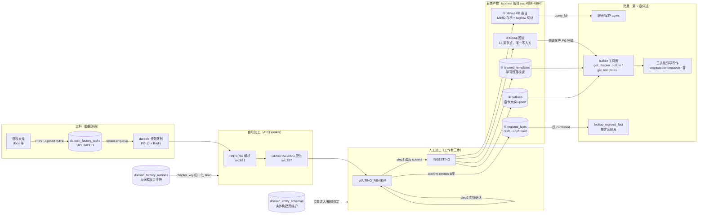
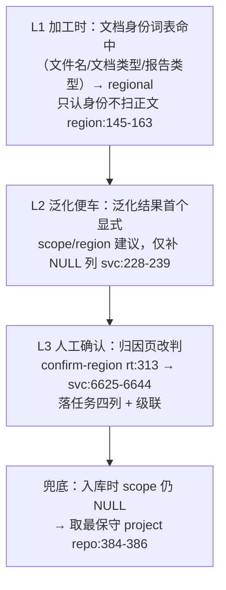
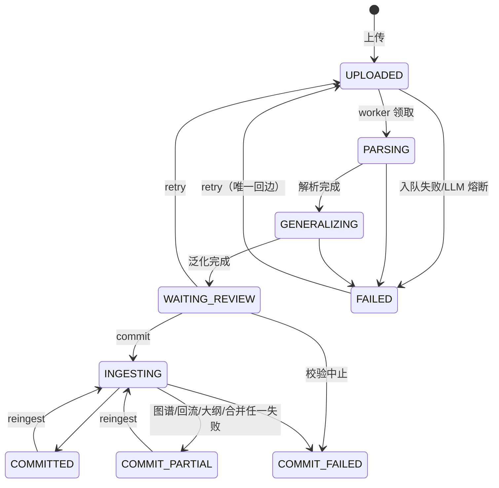

# 通用域知识工厂全景梳理：数据加工 × 消费 × 关联

> 快照日期：2026-11-13，基于当前工作树（pisuan-localized 分支，含未提交改动）。
> 方法：5 路并行代码取证（前端 7 页 / 任务管线 / admin 页与数据模型 / 归因图谱知识库 / 外部消费方）+ 人工交叉复核。
> 引用缩写：`rt` = backend/server/routers/domain_factory_router.py；`svc` = backend/package/pisuan/services/domain_factory_service.py；`repo` = backend/package/pisuan/repositories/domain_factory_repository.py；`models` = backend/package/pisuan/storage/postgres/models_domain_factory.py；`region` = backend/package/pisuan/services/domain_factory_region.py；`tools` = backend/package/pisuan/agents/toolkits/buildin/tools.py。
> 范围：通用域 7 页逐页深拆；EIA（环评）侧、Agent/技能、图谱、知识库作为外部关系简述（第 5 章）。

---

## 1. 模块定位与总体架构

### 1.1 定位

通用域知识工厂是 Pisuan 的**语料加工通用管线**：把上传的领域语料（docx 等）经 ETL 解析 → LLM 泛化 → 人工三步审核后**一次性入库**，产出五类知识资产，供 Agent 工具、内建技能与写手智能体消费。它与 EIA（环评）侧共享同一个 `/domain-factory` router、同一套 KB 基建与消费工具面，但 **ETL 任务产线、图谱写入、归因/区域事实产线为通用域独占**（图谱节点 domain 恒为 `general`，svc:4770）。

一句话数据主线：**语料 → 任务（UPLOADED→…→WAITING_REVIEW）→ 工作台三步人工审核 → commit → 五类产物 → Agent/技能消费**。

### 1.2 页面清单

路由挂载：`web/src/router/index.js:252-306`（`/factory/general/*`，壳 `web/src/components/factory-core/GeneralLayout.vue`）。

| # | 页面 | 路由 | 组件（壳 → 实现） | 鉴权 | 职责 |
|---|---|---|---|---|---|
| 1 | 总览 | `/factory/general/overview` | GeneralOverviewView.vue（1018 行，纯静态） | 登录 | Landing 复刻：四工位导航卡，**零 API 调用** |
| 2 | 数据源 | `/factory/general/data-sources` | GeneralDataView.vue（16 行壳）→ DataSourceDashboard.vue | 登录 | 上传语料、任务列表（15s 智能轮询）、原文预览、历史 |
| 3 | 工作台 | `/factory/general/workbench` | GeneralWorkbenchView.vue（41 行壳）→ EtlWorkbench.vue（3205 行） | 登录 | 三步审核（段落→实体→入库）+ commit |
| 4 | 归因 | `/factory/general/attribution` | GeneralAttributionView.vue（8 行壳）→ RegionAttributionPanel.vue（三子页） | 登录 | 任务归属改判、区域事实管理、模板聚合看板 |
| 5 | 提示词配置 | `/factory/general/prompt-config` | PromptConfigView.vue（466 行） | admin | 维护 ETL 泛化等提示词模板 |
| 6 | 大纲模板 | `/factory/general/outline-template` | DomainOutlineTemplateView.vue（106 行壳）→ OutlineTemplate.vue（831 行） | admin | 维护标准 13 章大纲模板树（图谱 + PG 双形态） |
| 7 | 实体构建 | `/factory/general/entity-builder` | DomainEntityBuilderView.vue（1675 行） | admin | 实体 Schema 库 CRUD + AI 提取，domain 恒 `general` |

模块外但强关联的 UI：
- **TaskCenterDrawer**（`web/src/layouts/AppLayout.vue:29,533`）：全局任务中心抽屉，admin 挂载，消费 `/domain-factory/tasks-center` 端点（经 `web/src/stores/tasker.js:109-164` 合并去重）。
- **GeneralLayout 侧栏**：216px chrome 与 EIA 侧 `EiaDataLayout.vue` 同配方；「规范库加工」是抽屉（RegulationEnrichPanel，GeneralLayout.vue:49,88,104-108）**不建独立页面**；admin 组 3 页仅管理员可见（:92-113）；底栏「返回知识工厂」→ `/domain-factory`（:36-39）。

### 1.3 总体数据流图

---

## 2. 核心数据资产盘点

### 2.1 通用域表清单（models_domain_factory.py，ORM Base models:24）

| 表 | 用途 / 关键字段 | 主要写方 | 主要读方 |
|---|---|---|---|
| `domain_factory_domains` | 领域字典；去领域化后仅 `general` 一行（repo:176-190） | get_or_create_general_domain | GET /contexts、实体构建页 /domains |
| `domain_factory_tasks` | ETL 主表：status 九态、scope（universal/regional/project）、归因四列（region_label/region_key/scope/project_name models:94-97）、raw_markdown、source_paragraphs、template_payload/metadata、validation_report | create/update/commit_task/begin_ingest（repo:282-388） | 数据源页、工作台、归因页 GET /tasks、region-board |
| `domain_factory_kb_attributions` | KB ↔ 归属持久绑定 | assert_kb_attribution_compatible（repo:389-534）；v21 迁移回填（manager:970-1009） | get_kb_attribution（repo:411） |
| `domain_factory_learned_templates` | 学习段落模板；唯一键 (domain, report_type, chapter, slot_signature, **attribution**)（models:145-152） | commit 回流 upsert（svc:5675-5727 → repo:562） | get_templates 回退源（tools:973）、region-board |
| `domain_factory_outlines` | 章节大纲；唯一键 (domain, report_type, canonical_chapter_key, **attribution**)（models:230-236）；Tier1 文字字段 + artifact + content_contract + rigidity | upsert_outline（repo:650）：commit 产线 / 大纲提取确认 | 写手工具回退、大纲模板详情页、lookup_chapter_order（repo:960） |
| `domain_factory_prompt_configs` | 提示词；唯一键 (domain_code, report_type_code, prompt_type)（models:197-222） | PUT /prompt-config（svc:6043） | ETL 泛化管线（svc:402-422，**当前断裂，见 §7.1**） |
| `domain_factory_reports/_chapters/_pps` | 写作侧：report.status draft/writing/assembled；chapter.status pending/writing/done/skipped；pps value_type number/string/enum | 写手 agent 工具（tools:1013-1238 → repo:808-1023） | get_report_snapshot（tools:1043）、assemble_report |
| `domain_factory_tool_usage` | W0 工具取用率台账，只增；source=graph/db/db_fallback/miss（models:378-406） | tools._track_usage（tools:32-62，fire-and-forget） | 暂无读方（测量预留） |
| `domain_factory_regional_facts` | 区域事实：fact_type=monitoring/sensitive_target/measure/constraint；status=draft/confirmed/retired；v22 加 kb_id/attribution 列（models:409-446） | confirm-entities 插草稿、confirm-region 升级、retire（repo:1111-1167） | 归因页两表 + 看板、lookup_regional_fact |
| `domain_entity_schemas` | 实体 Schema：entity_key unique、category 六分类（project_basic/natural_env/env_quality/sensitive_target/measures_regulation/impact_assessment，tools:6324-6330）、properties JSON、relation_rules（models_domain_entity.py:15-53） | 实体构建页 CRUD / 工作台 confirm-entities | ETL 变量注入（svc:456+）、槽位绑定推荐、list_report_types（tools:755） |
| `report_types` | 报告类型字典 | DomainEntityRepository | list_report_types 工具、上传表单 |

### 2.2 五类产物形态

1. **KB 条目**：commit 阶段 2 组装 ingest markdown → MinIO 存档（md+原文件）→ KB 文件记录 `file_id=df_<hash(task|kb)>` 直置 PARSED → `kb_manager.index_file` ragflow 式切块向量化（svc:4658-4701；结构化 LightRAG 直写 v0.7.0 已退役，svc:4697-4699）。作为普通知识库被任意聊天 agent 的 query_kb 检索。
2. **图谱**：阶段 2.5 `GraphBuilder.build_knowledge_graph` 写 Neo4j（svc:4742-4795）。数据源 = task.source_paragraphs（每段含泛化模板/slots/legal_references/table_schema/formula 等 ETL 产物）。16 类节点：Document/Section/ParagraphTemplate/Slot/EntitySchema/LegalReference/TableSchema/FormulaTemplate/ProcessFlow/ProcessStep/DomainOutline/ChapterTemplate/ParagraphRole/CausalChain/ConditionRule/DataFlow（graph_builder.py:1-31）；归因掺入节点 ID（graph_builder.py:156,1054-1056,1945-1958）。
3. **学习模板**（learned_templates）：段落级模板回流 PG，归属键 attribution 进唯一约束——同章不同归属可并存。
4. **章节大纲**（outlines）：逐章 upsert PG + 图谱 DomainOutline meta 回写；跨报告 key_points/content_contract 合并进 13 个 std 种子章节 ChapterTemplate（svc:4401-4484）。
5. **区域事实**（regional_facts）：唯一产生点是工作台 step2 确认 B 类新实体（svc:6607-6623 → draft），confirm-region 级联升 confirmed（repo:1145-1156），retire 只改状态不删行留审计（repo:1158-1168）。**不进图谱**。

### 2.3 归因（attribution）：贯穿全模块的隔离键

**定义**：`hashstr(kb_id|region_key|scope|project_name, 12)`（region:216-230）；空归属返回 `""` 兼容存量共享行。

**三层判定**（由粗到细，逐层可覆盖）：

**隔离语义**（fail-closed）：
- KB ↔ 归属一库一绑定：同一 KB 已绑定归属 A 后，归属 B 的任务入库被拒（提交口预检 svc:4318-4325 + begin_ingest 事务内权威检查 repo:348-387；测试 `backend/test/integration/storage/test_domain_factory_attribution_isolation.py:82-129`）——防止两份区域数据混进同一向量集合。
- 模板/大纲唯一身份含 attribution：按归属读取互不覆盖。
- 图谱查询按 attribution 优先、否则 kb_id 过滤；std 种子章节恒共享，模板不跨归属共享（graph_query_service.py:25-52）。
- agent 工具面 `_resolve_graph_scope`（tools:65-92）：会话 KB 不可见 / mixed 归属 / 未绑定归属一律拒绝（fail-closed）。

---

## 3. 分页详拆

每页统一结构：职责 → 操作→API→服务链路 → 加工过程 → 产物与消费方 → 与其他页的关联。

### 3.1 总览页 GeneralOverviewView

- **职责**：知识工厂 Landing 的一比一独立复刻（自 DomainFactoryView 整拷，:1-5 注释），后续两侧各自演化。**零 API 调用**。
- **内容**：hero「领域知识工厂」（:18-22）+ 四工位卡（:152-193）：语料进料→数据源、ETL 清洗→工作台、归属入库→归属管理（归因页）、写手消费→eia-data（跨域）；收工带 CTA「进入通用域 / 浏览环评域」（:114-124）。
- **关联**：唯一出口是导航跳转；是整个模块的入口地图。

### 3.2 数据源页（GeneralDataView → DataSourceDashboard）

- **职责**：语料进料口 + 任务状态监视器。
- **操作链路**：
  - 「上传新报告」→ `getContexts` 取通用域报告类型（Dashboard:255-264）→ 逐文件 `POST /upload`（带 document_type+report_type_code，:326）→ 500ms 后刷新列表 + `taskerStore.loadTasks`（联动全局任务抽屉）+ 启动轮询。
  - 行内「校验」（WAITING_REVIEW 态）→ `router.push('workbench?task=<id>')`（GeneralDataView.vue:14）下钻工作台。
  - 眼睛图标 → `getTaskMarkdown` 弹窗看原文（:223）；FAILED → `retryTask`（:201）；COMMIT_FAILED/PARTIAL → `reingestTask`（:212）；删除 → `deleteDataSource`（:186，单个/批量循环）。
- **加工过程**：本页不做加工；上传即建 `domain_factory_tasks` 行（UPLOADED）+ 注册 durable 任务，解析发生在 ARQ worker（见 3.3）。
- **轮询**：15s setInterval，**仅当存在 UPLOADED/PARSING/EXTRACTING/GENERALIZING 活动任务时运行**，无活动任务自停（Dashboard:39-48）。
- **产物/消费**：无产物；消费 GET /data-sources（七态列表 repo:245-263）、GET /history（COMMITTED/REJECTED 终态，repo:265-280）。
- **关联**：→ 工作台（下钻）、→ 任务中心抽屉（上传/刷新时 loadTasks）。

### 3.3 工作台（GeneralWorkbenchView → EtlWorkbench）

模块的加工中枢，三步 Tab（EtlWorkbench.vue:1031-1051）：

**Step 1 段落分类审核**
- 数据：worker ETL 产出的 structured_blocks/source_paragraphs（章节树前端构建 buildChapterTree:467；右栏五类渲染 heading/legal_reference/table/formula/figure/prose）。
- 操作：「运行校验」`validateTask`（纯只读，PreCommitValidator+SlotValidationService，报告写 validation_report 列不改状态，svc:4143-4217）；「智能识别实体」`discoverEntities`（规则绑定 slot→entity_ref + LLM 分析未绑定 slot，出现 ≥3 段为候选；建议直接回写段落，其余存 template_metadata.entity_proposals，svc:6191-6302）；保存 `saveTaskStep(step='structured')`（:692）；JSON 编辑开关（:659）；泛化模板选字新建 Slot（实体绑定推荐来自实体 Schema 前端三级匹配 suggestEntityBindings:114，数据源同实体构建页的 Schema 库）。

**Step 2 领域实体确认**
- 数据：entity_proposals（从任务 metadata 读取，不触发 LLM，:889）。
- 操作：逐条/批量 `confirmProposedEntities`（:935/953/967）→ 后端写 `domain_entity_schemas`（new_entity 建 metadata.source=etl_proposal 行；add_property 追加 properties，svc:6451-6555）；**B 类新实体级联插区域事实 draft**（svc:6607-6623）；最后重映射同域 WAITING_REVIEW 任务（svc:6557）。

**Step 3 入库确认**
- 统计卡 + 变量汇总 + 选 Milvus 知识库（`databaseApi.getDatabases` 过滤 milvus，:784）→ `handleCommit`（:799）先保存三步数据再 `commitTask`（form=slot 汇总+structured+source_paragraphs+knowledge_base_id）。

**任务状态机**（合法迁移表 TASK_STATUS_EDGES repo:100-122，非法迁移 raise ValueError repo:125-131）：

注：EXTRACTING 的唯一写点 svc:4247 无调用方，是死代码状态（repo:98 审计注释）；REJECTED 仅存活于 history 过滤（repo:272）。

**commit 管线**（异步，ARQ worker `_commit_pipeline_async` svc:4558-4894，幂等 key `ingest_<task_id>`）：
1. 守卫：无 kb_id 拒绝、保 WAITING_REVIEW（svc:4583-4593）；PreCommitValidator 失败 → COMMIT_FAILED（svc:4602-4615）。
2. `begin_ingest` → INGESTING + advisory lock 锁「一库一归属」（repo:477-533）。
3. KB 入库（阶段 2，svc:4636-4715）：组 ingest markdown → MinIO → KB 文件记录 → index_file 切块向量化。
4. 图谱写入（阶段 2.5，svc:4742-4795）：build_knowledge_graph，doc_id=`doc_<task_id>`。
5. 模板回流（svc:4815,5675-5727）→ learned_templates。
6. 大纲 upsert（svc:4826,5175-5273）→ outlines + 图谱 meta 回写。
7. 跨报告合并（svc:4841,4401-4556）→ 图谱 ChapterTemplate。
8. 任一失败 → COMMIT_PARTIAL + partial_errors（svc:4785-4790,4818-4846）。

**reingest**（svc:5729-5966）：仅 COMMIT_* 态；复用 commit 的 KB+图谱路径，file_id=`df_ri_<hash>`；无 kb 时仅重建图谱。
**retry**（svc:5979-6022）：PARSING/GENERALIZING/INGESTING 拒绝；置回 UPLOADED；已存段落时 `payload.resume=true` 断点续跑只补泛化失败段（svc:802-813）；LLM 连续断供熔断 → FAILED 但保留已成功段落（svc:968-986）。

**异步底座**：Tasker（PG durable 行 + Redis 发布，task_service.py:144-159,283-311）→ ARQ worker（server/worker_main.py；claim 带 lease，并发上限 `DURABLE_TASK_MAX_RUNNING=4`，心跳 + cancel watcher + 6h 超时，task_service.py:30-31,433-558）；worker 周期 reconcile 失联任务并补发 pending（run_worker.py:1519-1531）；失败经 failure handler 收敛领域行状态（svc:7023-7060）。

- **产物/消费**：commit 产出全部五类资产（§2.2）；本页还间接写实体 Schema（step2）。
- **关联**：← 数据源页下钻；→ 数据源页（task-completed 跳回，GeneralWorkbenchView.vue:28-32）；→ 任务中心（admin 在 task-updated 时 syncTaskToTaskCenter，:34-40）；↔ 实体构建页（共享 Schema 库）；归因页改判影响本页任务归属显示。

### 3.4 归因页（GeneralAttributionView → RegionAttributionPanel 三子页）

- **职责**：归属治理中枢——任务归属改判（L3）、区域事实生命周期、模板聚合视图。
- **三子页**（a-tabs，v-show 保状态 :37-44）：
  1. **任务归属** AttributionTaskTable：scope chips（全部/regional/project/universal/未归属）+关键词+region tag 过滤 → `GET /tasks`（带分页，scope=unassigned 解释为 IS NULL，repo:1218-1268）→「改判」弹 AttributionEditModal → `confirm-region`。
  2. **区域事实** RegionalFactsTable：region 下拉（候选取自 region-board 的 region_tree）+fact_type+status 过滤 → `GET /regional-facts`；admin 多选 → `retireRegionalFacts`（Modal 二次确认「不可恢复」，:111-133；实际只改状态留审计）。
  3. **模板聚合** RegionBoard（只读）：`GET /region-board` 单响应聚合 stats+templates+region_tree（svc:6923-6998；模板 region 由归因集派生，恰一 region 才计入统计，多 region=mixed 只进明细，region:188-200）；区域卡片下钻 emit jump-to-tasks/facts → 父组件 ref 调子页 `applyRegionFilter` 带参跳转（Panel:14-21）。
- **confirm-region 级联**（svc:6625-6678，本页核心加工动作）：
  1. 落任务归因四列（label 未登记词表须显式传 key，region:84-86；17 条矿区 slug 词表 REGION_VOCAB region:19-37 与前端 AttributionEditModal 硬编码词表人工同步）。
  2. `confirm_facts_for_task` 覆盖回填该任务事实 region_key，draft/confirmed → confirmed（repo:1145-1156）。
  3. 归因集模板 min-permissive 重算 scope（project < regional < universal，永不升级，region:166-185）。
  级联结果 toast 显示 facts_confirmed/templates_recalculated（Modal:85-91）；子页切换强制 refresh 防 stale（Panel:24-27）。
- **产物/消费**：改写任务归因四列 + 区域事实状态 + 模板 scope；消费 /tasks、/regional-facts、/region-board 三组读端点。
- **关联**：改判影响工作台（任务归属列）、影响 agent 工具面（lookup_regional_fact 只读 confirmed 且按 region_key 隔离）、影响图谱查询过滤（attribution 优先）；KB 绑定兼容性检查决定工作台 commit 能否选库。

### 3.5 提示词配置页 PromptConfigView（admin）

- **职责**：维护 ETL 提示词模板。4 Tab：文档解析/模板泛化/Schema 生成/章节泛化。
- **链路**：onMounted `getPromptConfig` → 空值回填前端内置默认（defaultPrompts:22-124）→ 保存 `updatePromptConfig`（:158）；支持重置为默认、点变量 tag 插入 `{var}`（:179-188）。
- **后端三层模板源**（svc:401-441）：代码内置 `_PROMPT_DEFAULTS`（svc:284-399）← `config/static/prompt_templates.yaml` ← DB 行覆盖。缓存失效后重载（svc:6047）。
- **消费环节**：理论上四键分别服务不同 ETL 阶段；**实际只有 `template` 键被消费**（worker 泛化段 svc:3382-3384,3516-3540）。extract 键的死代码 `_build_extract_prompt`（svc:3139-3170）无调用点（EXTRACT 阶段已废弃，svc:852-854）；schema_generation/section_generalization 无消费点。
- **已知断裂**：见 §7.1——前端提交键带 `_prompt` 后缀导致**保存的配置回显丢失且不生效**。
- **关联**：配置质量直接影响 Step1 泛化产物（模板/slots 质量），间接影响图谱与学习模板。

### 3.6 大纲模板页（DomainOutlineTemplateView → OutlineTemplate，admin）

- **职责**：维护标准 13 章大纲模板树——**图谱 std_ ChapterTemplate 节点 + PG outlines 双形态**。
- **链路**：onMounted `getContexts`+`getOutlineTemplates`（:553-556；读图谱 ChapterTemplate std_ 树，graph_query_service.py:520-594，key 编码 `canonical||level`）→ 左树选章 `getOutlineTemplate` 拉详情（图谱 meta + PG 富字段合并，svc:5275-5313）→ 编辑 purpose/key_points/writing_hints/regulations/extraction_regex/expected_* → `updateOutlineTemplate`（白名单字段，graph_query_service.py:596-661；std 节点优先）。
- **四个加工动作**：
  - 「初始化标准 13 章结构」`seedOutlineTemplates`（幂等重建 Neo4j std 种子，rt:737-776）。
  - 「从报告提取大纲」上传 docx → `extractOutlinePreview`（python-docx 读 heading + 每章 LLM 归一化，svc:5315-5374）→ 预览确认 `confirmOutlineExtract`（PG upsert_outline(source_task_ids=["outline_extract"]) + GraphBuilder 建样例 + 骨架归纳回填 frequency/rigidity，svc:5415+）。
  - 「生成提取正则」`generateExtractionRegex`（对 std_ level=1 逐章 LLM 生成 extraction_regex 写回图谱，svc:5612-5673）。
- **产物/消费**：outlines/std ChapterTemplate。消费方：① 工作台 commit 产线——list_chapter_keys 作大纲归一化 seed keys（svc:5185,5346）；② agent 工具 get_chapter_outline/list_chapter_keys（图谱优先 PG 回退）；③ compliance-checker 取 regulations。
- **关联**：为工作台加工与写手链路提供「章节骨架基准」；大纲模板页编辑的 extraction_regex 服务后续大纲提取精度。

### 3.7 实体构建页 DomainEntityBuilderView（admin）

- **职责**：通用域实体 Schema 库的维护台。**走独立 router `/api/domain-entity-builder/*`**（`backend/server/routers/domain_entity_builder_router.py:16-18`，全端点 admin），与工作台的 discover-entities 系列无关，也非 `/eia/entities/*`（那是 EIA 侧 EntitiesPanel）。
- **链路**：onMounted 并行 `getTaxonomy`+`listEntitySchemas`（:852）；支持 `?entity_key=` 深链定位（:866-869,1244-1250）；左树 domain→entities + 新建；右侧编辑元数据/属性结构（弹窗 CRUD，本地数组 :1049-1108）/图谱关系推理规则（:1111-1168）→ `create/update`；克隆/JSON 导出/导入/删除。
- **AI 提取向导**（两步，:1271-1323）：`extractEntities(file,'general')` → comparison 表勾选 → `importExtractedEntities(selected,'general')`。**domain_code 恒 'general'**（:822,943,1173,1275,1311，「去领域化」）。
- **数据模型**：`domain_entity_schemas`——实体即 Schema 定义，属性嵌在 properties JSON 数组，无独立 items 表（models_domain_entity.py:15-53）。category 六分类。
- **产物/消费**：实体 Schema。消费方：① ETL 泛化/变量注入（svc:456+）；② Step1 槽位绑定推荐（前端三级匹配 suggestEntityBindings）；③ Step2 confirm-entities 写入同一 Schema 库；④ agent 工具 list_report_types；⑤ lookup_regional_fact 的实体→事实映射源自 B 类实体确认。
- **关联**：是工作台 Step1/Step2 的**数据基准**——构建器保存的实体属性直接影响槽位推荐与实体发现结果。

---

## 4. 页间关联矩阵

### 4.1 数据依赖（谁的数据被谁读）

| 产出方 ↓ \ 消费方 → | 数据源 | 工作台 | 归因 | 提示词 | 大纲模板 | 实体构建 | 外部（agent/技能） |
|---|---|---|---|---|---|---|---|
| **数据源页**（任务行） | — | 读任务详情/段落 | 读任务列表 | | | | 任务中心抽屉 |
| **工作台**（commit 产物） | 读历史 | — | 读归因集派生 region | | 读 commit 回流的 outlines | 写 Schema | 图谱/模板/大纲/KB 全量消费 |
| **归因页**（改判/事实） | 任务归属列变化 | commit 选库受 KB 绑定约束 | — | | | | lookup_regional_fact |
| **提示词页**（配置） | | 泛化管线消费（当前断裂 §7.1） | | — | | | |
| **大纲模板页**（std 树） | | chapter_key 归一化 seed | | | — | | get_chapter_outline |
| **实体构建页**（Schema） | | 槽位推荐 + 实体发现 | | | | — | list_report_types |

### 4.2 操作联动（谁的动作触发谁的变化）

| 触发动作 | 级联效果 |
|---|---|
| 数据源页上传 | 建任务行 + durable 入队 + taskerStore.loadTasks（任务抽屉）+ 启动 15s 轮询 |
| 数据源页「校验」 | 跳转工作台 `?task=<id>`（watch route.query 重置状态重拉详情，EtlWorkbench.vue:993-1007） |
| 工作台 discover-entities | 建议回写段落 + entity_proposals 入任务 metadata → Step2 可见 |
| 工作台 confirm-entities | 写实体 Schema + B 类实体级联插区域事实 draft + 重映射同域 WAITING_REVIEW 任务 |
| 工作台 commit | 五类产物落库（§3.3 八步管线）+ task-completed → 跳回数据源页 |
| 工作台 task-updated（admin） | syncTaskToTaskCenter 回写全局任务行 |
| 归因页 confirm-region | 任务四列 + 事实 confirmed + 模板 scope 重算 + （切子页强制刷新） |
| 归因页 retire | 事实 status→retired（不删行）→ lookup_regional_fact 立即不再返回 |
| 大纲模板页 confirm 提取 | outlines upsert + 图谱样例 + ChapterTemplate 骨架归纳 |
| 大纲模板页 generate-regex | extraction_regex 写回图谱 std_ 章节 |
| 实体构建页保存/导入 | 下次工作台槽位推荐与实体发现即时受影响（前端三级匹配读最新 Schema） |

---

## 5. 外部消费与供给

### 5.1 Agent 工具面（tools.py，buildin 工具池）

注册：`@tool` 装饰器导入时进全局池（toolkits/registry.py:85）；绑定两路——agent 配置 `context.tools`（toolkits/service.py:103-114）与 Skill 激活门控 tool_dependencies（middlewares/skills.py:104-117）。

| 工具 | 数据源 | 消费场景 |
|---|---|---|
| get_chapter_outline（tools:656） | 图谱→PG 回退，带 `_source`/`_degraded_note` | chapter-writer 预置（presets/subagents/chapter_writer.py:12）、compliance-checker |
| list_report_types（:755） | report_types 字典 | 3 技能 + 写手 prompts |
| list_chapter_keys（:779） | 图谱→回退 | compliance-checker |
| list_leaf_sections（:833） | 仅图谱（无回退） | template-recommender |
| get_templates（:876） | 图谱（section_key 精确查，失败 `_source=graph_error` 不回退同名 canonical）；canonical 路径图谱→repo 回退 | template-recommender、slot-filler、chapter-writer |
| create/get_report、set_pps_param、save_chapter、assemble_report（:1013-1238） | reports/chapters/pps 表（写作侧回写） | chapter-writer 预置；excluded_tools 中间件禁 write_file 强制走 save_chapter |
| lookup_regional_fact（:1437） | regional_facts，**仅 confirmed、region_key 必填隔离** | 未见 preset/skill 引用（经管理端 agent 配置下发，未确认具体 agent） |
| lookup_standard_indicator 等计算/查表类 | regulation_library / milvus KB | coal-eia-writer 等写手 |

横切机制：工厂读工具全部写 W0 取用率埋点 → `domain_factory_tool_usage`（tools:32-62）；图谱工具统一 `_resolve_graph_scope` 可见性校验（tools:65-92）。

### 5.2 三个内建技能与引导写作链路

- **template-recommender**（v2026.11.12）：逐节引导写作，四卡循环「选节→选模板→补数据→确认」（SKILL.md:98-130）。工厂数据进入点：开局定位（list_leaf_sections 叶子节清单）、卡2 选模板（get_templates 图谱模板 + query_kb 参照轨）、卡3 补全（插槽值=上下文+query_kb 检索 KB 条目）。
- **slot-filler**：**已被 template-recommender 接管**（SKILL.md:11，接管声明 2026-11-09），仅供存量会话按旧协议批量填槽；`skill_dependencies=["template-recommender"]`。两者**不再构成串行流水线**。
- **compliance-checker**：独立后置校验——get_chapter_outline 取每章 regulations/content_requirements → query_kb 检索法规原文 → 逐章五维比对，对已写成稿，非强制链环节。
- **反例**：coal-eia-writer 自 2026-10-22 模板依赖剥离，不查工厂模板/大纲（SKILL.md:287），仅用 lookup_standard_indicator——说明消费是按 agent 装配的，不是全局强加。

### 5.3 图谱查询服务（graph_query_service.py）

只读 Cypher 消费面：list_chapter_keys:138、list_leaf_sections:162、get_chapter_outline:190、get_templates；过滤 attribution 优先、否则 kb_id，std 种子恒共享（:25-52）。消费方仅三类：buildin 工具层、domain_factory_router 图谱 HTTP 端点（管理面 rt:678,720）、domain_factory_service 内部（大纲装配 svc:5283,5622）。**无任何聊天 agent 直接调用 GraphQueryService**——图谱对问答侧的唯一入口就是 agent 工具。

治理脚本（scripts/governance/）：fix_existing_graph（幂等修存量分支/编号/canonical）、rebuild_legal_citations（按 PG source_paragraphs 精确重算 CITES 来源边）、merge_chapter_templates（canonical 归一 + 重复 ChapterTemplate 合并 + PG↔图谱 meta 回写）。

### 5.4 知识库

通用域产物以**普通 KB 文件**形态入库（commit 阶段 2），消费与任何其他 KB 无异：聊天 agent 的 query_kb → KnowledgeBaseManager 分发（LightRAG/Milvus/Dify）。可见性由会话 context.knowledges 决定（agents/context.py:238），与图谱侧 `_resolve_graph_scope` 同套归属隔离哲学。EIA 侧 push-kb 走同一 index_file 入口（eia_corpus_task_service.py:98）但**不写图谱**。

### 5.5 任务中心（全局 Tasker）

GET /domain-factory/tasks-center（rt:537-584，admin）从全局 Tasker 过滤 type=domain_factory，按 payload.task_id 关联领域行，用 DOMAIN_FACTORY_STATUS_MAP（rt:590-604）叠加为 running/success/failed+progress；durable 终态不被领域行滞留执行态覆盖（rt:569-580）。消费 UI 是 TaskCenterDrawer 全局抽屉（非独立页面）；POST /tasks/{id}/sync-task-center（admin）手动对账。

### 5.6 EIA 侧共享点（简述）

- **共享**：同一 /domain-factory router；同一 KB 基建（index_file）；同一 PG manager/迁移体系；图谱与工具消费侧两侧共用（写手 domain 形参被覆盖为 general，tools:670,759,887）；models 同文件含 eia_* 运营裁决表（models:449-909）。
- **通用域独有**：ETL 任务管线与 commit 入库（唯一图谱写入方）、归属/区域事实/region-board 产线、outline + learned templates 产线。
- **EIA 独有**：语料文件库（eia_library_*）、词表/标准/公式/范式等运营表 + 显式物化导出；EIA 语料只进 KB 不进图谱。

---

## 6. 附录：端点 → 页面 → 服务映射

### 6.1 /domain-factory 通用域端点（非 /eia/*）

| 端点（rt 行号） | 页面 | 服务层入口 | 数据读写 |
|---|---|---|---|
| GET /data-sources（:45） | 数据源 | list_pending_tasks | 读 tasks（七态） |
| GET /history（:60） | 数据源 | — | 读 tasks（终态） |
| GET /tasks/{id}（:75） | 工作台 | svc:4103 | 读 tasks 全字段 |
| GET /tasks/{id}/markdown（:94） | 数据源 | — | 读 raw_markdown |
| PUT /tasks/{id}（:116） | 工作台 | svc:4252 | 写 base_info/structured/template 三步 |
| POST /tasks/{id}/validate（:136） | 工作台 | svc:4143 | 只读+写 validation_report |
| POST /tasks/{id}/discover-entities（:158） | 工作台 | svc:6191 | 写段落回写+entity_proposals |
| GET /tasks/{id}/proposed-entities（:277） | 工作台 | svc:6401 | 读 unrecognized_slots 分类 |
| POST /tasks/{id}/confirm-entities（:292） | 工作台 | svc:6451 | 写 entity_schemas + regional_facts(draft) |
| POST /tasks/{id}/confirm-region（:313） | 归因 | svc:6625 | 写 tasks 四列+facts 升级+模板 scope |
| POST /tasks/{id}/commit（:177） | 工作台 | svc:4305→worker:4558 | 五类产物全量写 |
| POST /tasks/{id}/reingest（:216） | 数据源 | svc:5729 | 复用 commit 管线 |
| POST /tasks/{id}/retry（:258） | 数据源 | svc:5979 | 置 UPLOADED 重入队 |
| DELETE /tasks/{id}（:239） | 数据源 | svc:5968 | 删文件+删行（facts FK SET NULL） |
| GET /tasks（:356） | 归因 | svc:6884 | 读 tasks（scope 分页） |
| GET /regional-facts（:381） | 归因 | svc:6902 | 读 facts |
| POST /regional-facts/retire（:336，admin） | 归因 | repo:1158 | 写 facts.status |
| GET /region-board（:406） | 归因 | svc:6923 | 聚合 stats/templates/region_tree |
| POST /upload（:424） | 数据源 | svc:534-619 | 写磁盘+tasks+入队 |
| GET /prompt-config（:480） | 提示词 | svc:6027 | 读 prompt_configs |
| PUT /prompt-config（:494） | 提示词 | svc:6043 | upsert prompt_configs |
| GET /contexts（:518） | 上传弹窗/大纲页 | svc:6054 | 读 domains/report_types+统计 |
| GET /tasks-center（:537，admin） | 任务抽屉 | list_tasks 映射 | 读 Tasker+tasks 关联 |
| POST /tasks/{id}/sync-task-center（:607，admin） | 工作台壳层 | — | 写 Tasker 行 |
| GET /outline-templates（:671） | 大纲模板 | gqs:520 | 读图谱 std ChapterTemplate |
| GET /outline-templates/{key}（:691） | 大纲模板 | svc:5275 | 图谱 meta+PG 合并 |
| PUT /outline-templates/{key}（:711） | 大纲模板 | gqs:596 | 写图谱白名单字段 |
| POST /outline-templates/seed（:737） | 大纲模板 | 种子脚本复用 | 重建 std 13 章 |
| POST /outline-templates/extract（:779） | 大纲模板 | svc:5315 | 只读预览（LLM） |
| POST /outline-templates/confirm（:805） | 大纲模板 | svc:5415 | 写 outlines+图谱 |
| POST /outline-templates/generate-regex（:827） | 大纲模板 | svc:5612 | 写图谱 extraction_regex |

### 6.2 /domain-entity-builder 端点（实体构建页专用，全 admin）

GET taxonomy（:23）、GET/POST/PUT/DELETE entities（:73-143）、POST {id}/clone（:184）、POST entities/import-extracted（:208）、GET export（:235）、POST import（:250）、POST extract（:271）。前端封装 `web/src/apis/domain_entity_builder_api.js:9-76`。

### 6.3 /eia/* 端点

router:852 起约 80 个端点，服务 EIA 侧页面族（EiaLexiconView/StandardsView/…），本篇不展开，仅注意其与通用域共享 KB 基建与图谱消费面。

---

## 7. 取证发现（问题与死代码）

### 7.1 已修复（2026-11-13，bug-4244）：提示词配置键三重断裂（保存即失效）

证据链（代码级闭合，未运行验证）：
1. 前端提交键带 `_prompt` 后缀：`extract_prompt/template_prompt/...`（PromptConfigView.vue:15-18，:158 直接提交）。
2. PUT 原样落库：`save_prompt_config` 逐键 upsert，DB 中 prompt_type=`"template_prompt"`（svc:6043-6046）。
3. **回显丢失**：GET 再包一层后缀 → 返回键 `template_prompt_prompt`（svc:6038）→ 前端读 `cfg.template_prompt` 落空，回填默认值（PromptConfigView.vue:134-139）→ 用户保存的提示词在页面上消失。
4. **消费不生效**：`_load_prompt_templates` 按 prompt_type 原样覆盖 `templates["template_prompt"]`（svc:417）≠ 泛化管线消费键 `templates.get("template")`（svc:3384）→ **DB 自定义提示词永远不进 ETL，泛化永远用文件/代码默认**。

**修复**（当日实施）：PUT 落库前 `removesuffix("_prompt")`（裸键幂等，与 GET 加后缀对称）；运行栈 DB 存量 4 行（2026-04-29 写入）归一化剥后缀。验证：新增单测 `test_prompt_config_keys.py` 3 用例 + 同服务回归 23 passed；容器活体 `consumed_custom=True`（消费端首次拿到 272 字符自定义模板）、PUT→GET 回环匹配、原值还原。详见 changelog v0.7.3 功能与修复。

### 7.2 已排除：迁移链断链（误报）

取证中曾报告「BUSINESS_SCHEMA_VERSION=22 但 storage_migration.py 链止于 v21」——人工复核确认 `storage_migration.py:209` 存在 `upgrade_business_v21_to_v22()` 调用，链完整（v22 给 regional_facts 加 kb_id/attribution 列，manager:1034-1056）。

### 7.3 死代码 / 遗留

- EXTRACTING 状态：唯一写点 svc:4247 无调用方（repo:98 审计注释已标）。
- `_build_extract_prompt`（svc:3139-3170）：EXTRACT 阶段已废弃无调用点。
- 提示词 schema_generation/section_generalization 两键：页面可编辑但无消费点。
- REJECTED 状态：仅存活于 history 过滤（repo:272），无写入方。
- domainEntityBuilderApi 的 listDomains/getEntitySchema/batchDeleteEntities：前端已定义，7 页内无引用（全仓 grep 未命中，未确认他处使用）。

### 7.4 未确认消费方

create_report / assemble_report / lookup_regional_fact 未见 preset 显式注册，推断经管理端 agent 配置下发（DB 存储 agent 配置），具体使用 agent 待查。
